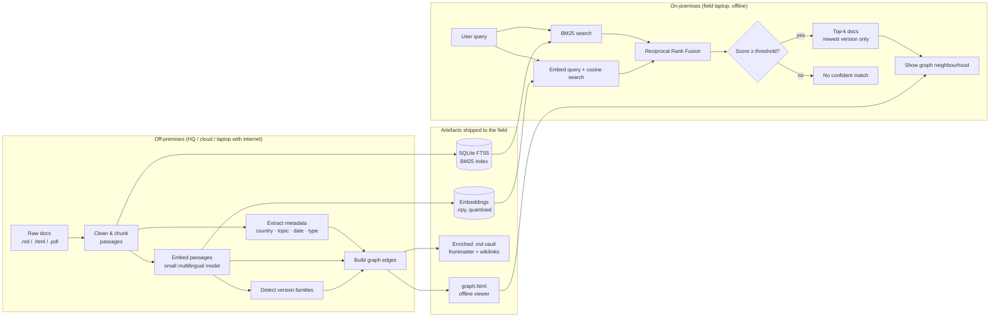

# MSF Document Retrieval – Research Note

> [!abstract] TL;DR
> - **Build our own retrieval pipeline** (keyword + semantic search). Obsidian alone cannot meet the brief: it's closed-source, has no relevance ranking and isn't a codebase.
> - **Keep the spiderweb feel** by having the pipeline *generate* the links between documents. Output them as `[[wikilinks]]` in the Markdown and as an offline HTML graph viewer.
> - **Handle version chaos** in two ways: detect near-duplicate *version families* during preprocessing, and use **Git** for syncing field copies.
> - Everything runs offline, on a laptop, with open-source tools only. That covers the effectiveness, implementability, cost and vendor-independence criteria.

Related: [[Pipeline Design]] · [[Evaluation Queries]] · [[Pitch Outline]] · [[Graph Viewer]] · [[Version Families]]

---

## 1. The challenge in one page

**Goal:** given a text query, return the relevant documents from an MSF collection of free-text documents. The topics range from medicine to administration, and the locations span several continents.

**Data:** original `.html` / `.pdf` files plus Markdown (`.md`) conversions. The `.md` files are easier to work with, but some images and figures were not parsed well.

**Constraints that drive the design**
- Retrieval must run **on-premises**: poor internet, limited storage, limited compute.
- **Preprocessing may run off-premises.** This is our loophole for doing the heavy work elsewhere.
- No dependency on a **single vendor**.
- External data and models are allowed if they are clearly sourced and compatible with the points above.
- Must search the **full collection**.

### Scoring criteria → what we show

| Criterion | What the jury wants | Our evidence |
|---|---|---|
| **Effectiveness** | Relevant documents found reliably and fast, few false positives | precision@5 on a labelled query set, query latency on a laptop, a confidence threshold |
| **Creativity** | Original, useful, adapts to new documents | Auto-generated knowledge graph, version families, incremental re-indexing |
| **Implementability** | Easy to maintain, low storage, poor internet OK, no vendor lock-in | SQLite + NumPy + a small open model, Git sync, a single HTML viewer |
| **Cost-effectiveness** | Low cost per query, to build and to maintain | €0 per query (no API), runs on existing laptops, open-source stack |
| **Presentation** | ≤ 5 min, clear procedure + design choices, demo | Live demo: query → ranked results → graph neighbourhood |

### Deliverables
- [ ] Modular, documented codebase (complete retrieval pipeline + preprocessing)
- [ ] Pitch of ≤ 5 min (slides / demo)
- [ ] *Optional:* notebook or lightweight app

---

## 2. Obsidian – what it offers and where it falls short

**What it is:** a local-first Markdown note app. A *vault* is just a folder of `.md` files. Its key features are `[[wikilinks]]`, backlinks, **graph view**, properties (YAML frontmatter), Canvas, and a large plugin ecosystem.

> [!success] Good fit for MSF
> - Fully offline, and data stays on the device
> - Plain-text Markdown means no lock-in at the *data* level
> - Free for work use since Feb 2025; non-profits never needed a commercial license
> - Linking mirrors how field knowledge connects: protocol ↔ outbreak report ↔ supply list ↔ lessons learned

> [!failure] Why it can't be *the* solution today
> - **Closed-source app owned by one company.** The brief penalises vendor dependence.
> - **Keyword search only.** No relevance ranking, no semantic matching, no control over false positives.
> - It's an app to configure, not a **codebase**, and the main deliverable is a codebase.
> - Weak collaboration: no real-time co-editing, and no per-user permissions inside a vault.
> - ⚠️ Not suitable for **patient data**: no access control, audit trail or compliance certifications.

> [!tip] How we still use it
> 1. Open the organisers' `.md` folder as a vault to **explore the collection** quickly.
> 2. Our preprocessing writes frontmatter and `Related: [[...]]` links into the `.md` files. The output then works in Obsidian **and** in every open-source alternative below.

---

## 3. Obsidian-like open-source alternatives

| Tool | License | Markdown files | Graph view | Offline | Notes for MSF |
|---|---|---|---|---|---|
| **Obsidian** | Proprietary (free) | ✅ | ✅ | ✅ | Most polished, but single-vendor and closed |
| **Logseq** | AGPL-3.0 | ✅ (legacy version) | ✅ | ✅ | Open source, but mid-transition: the new DB version (SQLite-backed) is still beta, and the Markdown version is in maintenance mode. Risky to standardise on |
| **Foam** | MIT | ✅ | ✅ | ✅ | VS Code extension. Great for our team, too technical for clinicians |
| **Quartz v4** | MIT | ✅ | ✅ (D3) | ✅ | Turns a Markdown folder into a **static website** with full-text search, backlinks and graph view. Needs Node 22+ to *build* (off-prem is OK). The output is plain HTML that opens in any browser |
| **Custom HTML viewer (ours)** | Ours (MIT) | ✅ | ✅ | ✅ | Built by our pipeline: semantic search **and** graph in one file. Best fit for the brief |

> [!note] Recommendation
> **Primary:** our own pipeline plus a single-file offline HTML viewer, with the graph library bundled in and no CDN.
> **Secondary / "browse mode":** the enriched `.md` vault, readable in Obsidian, Logseq or Quartz. If Quartz development stopped, its MIT license lets anyone fork it, and the static output keeps working regardless.

---

## 4. Architecture

---

## 5. Retrieval pipeline – design choices

### 5.1 Preprocessing (off-prem)
- **Chunking:** split on Markdown headings, then cap at ~200–400 tokens with a small overlap. Store `doc_id`, `chunk_id`, heading path and text.
- **Metadata:** title, date (from text or filename), country/location, document type (protocol, report, admin…), language. Use rule-based extraction plus a gazetteer for countries. Write it to YAML frontmatter.
- **Cleaning:** strip boilerplate (headers, footers, navigation from HTML). Where the `.md` lost content such as tables, fall back to parsing the PDF/HTML.

### 5.2 Keyword search: BM25
- **SQLite FTS5** (built into Python's `sqlite3`) or `rank_bm25`.
- Strong on exact terms: drug names, acronyms, place names, codes.

### 5.3 Semantic search: embeddings
- A small **multilingual** model, since MSF documents may mix English, French and other languages. Candidates: `multilingual-e5-small`, `bge-small` (English-only), or `paraphrase-multilingual-MiniLM`.
- Run on CPU, ideally via ONNX with int8 quantisation. *Check the size on disk and query latency on our laptop and record the numbers here.*
- Store embeddings as `float16`/`int8` in a `.npy` file. Brute-force cosine search is fast enough for thousands of chunks, so no vector database is needed.

### 5.4 Fusion and false-positive control
- **Reciprocal Rank Fusion:** `score(d) = Σ 1 / (60 + rank_i(d))` over the BM25 and embedding rankings. It's simple, needs no tuning and is robust.
- Aggregate chunk scores up to **document level** (max or top-2 mean).
- **Confidence threshold**, calibrated on our labelled queries. Below it, return *"No confident match"* instead of a weak guess. This is our main answer on false positives.
- *Optional:* a small cross-encoder reranker on the top 20, only if latency allows.

### 5.5 What we avoid, and why
- ❌ Cloud LLM / embedding APIs: they need internet, cost money per query and create vendor lock-in.
- ❌ Heavy vector databases or servers: maintenance burden, storage and compute.
- ❌ Large local LLMs for generation: too heavy for field hardware, and they risk hallucinating medical content.

---

## 6. The "spiderweb": an auto-generated knowledge graph

**Nodes:** documents (optionally also countries, topics and diseases as hub nodes).

**Edge types**

| Edge | How it's built | Why it's useful |
|---|---|---|
| `similar_to` | k-nearest neighbours on document embeddings (k = 5, cosine ≥ τ) | Surfaces related material the user didn't search for |
| `shares_entity` | Same country / disease / drug in metadata | Browse by context ("everything about cholera in DRC") |
| `links_to` | Explicit references and URLs found in the text | Respects the authors' own structure |
| `version_of` | Version-family detection (see §7) | Points to the latest version |

**Outputs**
1. A `## Related` section appended to each `.md` with `[[wikilinks]]`, so the graph appears in Obsidian, Logseq, Foam and Quartz for free.
2. `graph.html`: a single file using vis-network or Cytoscape.js, **inlined**. The search box highlights hits and their 1-hop neighbours, and clicking a node opens the document.

---

## 7. Version control

> [!question] Which problem does MSF actually have? Confirm with the partner.
> **A.** Several versions of the same document circulate, and people find outdated ones.
> **B.** Field copies drift out of date, and nobody knows which copy is current.

### A. Version families (preprocessing)
1. Candidate pairs: document embedding cosine ≥ ~0.95 **and** similar titles (normalised edit distance or token overlap).
2. Group pairs into families (connected components).
3. Pick the **canonical** version by date in metadata, then filename version markers (`v2`, `2024`, `rev`), then the latest modified date.
4. Retrieval returns only the canonical version, with a badge saying "N older versions". Add `supersedes: [[...]]` in frontmatter.
5. **Pitch angle:** this directly reduces false positives and stops clinicians acting on outdated protocols.

### B. Syncing field copies (Git)
- Plain-text Markdown plus **Git** gives full history, diffs, offline commits, and sync whenever a connection appears. Only the changes are transferred.
- Self-host with **Forgejo** or **Gitea** (open source) instead of GitHub, to stay vendor-independent.
- **Incremental re-indexing:** `git diff --name-only` tells us which documents changed, so only those are re-embedded and re-linked.
- Clinicians never touch Git directly. Wrap it in a single *"Update library"* button or script.
- Large binaries (PDFs) can use Git LFS, or be shipped alongside as a separate package.

---

## 8. Evaluation plan

- [ ] Write **15–20 realistic queries** across medical, logistics and admin topics and several regions. Include 2–3 queries with **no** correct answer to test the threshold.
- [ ] For each query, label the relevant document IDs (quick manual pass).
- [ ] Metrics: **precision@5**, **recall@10**, **MRR**, rate of correct "no match" answers, median query latency on a laptop CPU, total size on disk.
- [ ] Compare: BM25 only vs embeddings only vs hybrid (RRF) vs hybrid + threshold. One table, one chart.

| Variant | P@5 | R@10 | MRR | Latency (ms) | Disk (MB) |
|---|---|---|---|---|---|
| BM25 | | | | | |
| Embeddings | | | | | |
| Hybrid (RRF) | | | | | |
| Hybrid + threshold | | | | | |

---

## 9. Afternoon plan (14:00 → 18:00)

- [ ] **14:00–14:30**: Load the `.md` files, open them as a vault to explore, agree on the schema (`doc_id`, title, date, country, type)
- [ ] **14:30–15:15**: Chunking + BM25 (SQLite FTS5) working end-to-end
- [ ] **15:15–16:00**: Embeddings + RRF fusion + document-level aggregation
- [ ] **16:00–16:30**: Write and label the evaluation queries; calibrate the threshold
- [ ] **16:30–17:15**: Version families + graph edges → `## Related` in the `.md` files + `graph.html`
- [ ] **17:15–17:45**: Streamlit or notebook demo; README with run instructions
- [ ] **17:45–18:00**: Freeze the code, take demo screenshots, prepare the pitch

---

## 10. Pitch outline (≤ 5 min)

1. **Problem (30 s):** a doctor in a low-connectivity area needs the right protocol, fast.
2. **Approach (60 s):** off-prem preprocessing → on-prem hybrid search → confidence threshold.
3. **Demo (90 s):** query → ranked results → "newest version" badge → graph neighbourhood.
4. **Results (45 s):** the evaluation table, latency and disk footprint.
5. **Why it's deployable (45 s):** offline, €0 per query, open source, Git-based updates, no vendor lock-in.
6. **What's next (30 s):** feedback loop from field users, more languages, OCR for scanned PDFs.

---

## 11. Risks and open questions

- [ ] Languages in the collection? This decides between a multilingual and an English-only model.
- [ ] Are document dates reliable enough for version detection?
- [ ] Quality of the `.md` conversion for tables and figures. Is a PDF/HTML fallback needed?
- [ ] Target field hardware (RAM, disk)? This sets the model choice and quantisation.
- [ ] Does any document contain personal or patient data? If so, add a redaction step before indexing.

---

## Sources

- D4GC 2026 Challenge Document (organiser PDF, provided at the event)
- [Obsidian is now free for work – Obsidian blog](https://obsidian.md/blog/free-for-work/)
- [Obsidian license page](https://www.obsidian.md/license)
- [Obsidian Sync Standard plan – Obsidian blog](https://obsidian.md/blog/standard-plan/)
- [Logseq vs Obsidian 2026 – Toolradar](https://toolradar.com/compare/logseq-vs-obsidian)
- [Logseq – Contribute (AGPL-3.0)](https://blog.logseq.com/contribute/)
- [Quartz – AlternativeTo (MIT, features)](https://www.alternativeto.net/software/quartz--static-site-generator/about/)
- [Quartz overview (v4.5.2, Node 22+)](https://w1k1.pages.dev/tools/entities/quartz)
